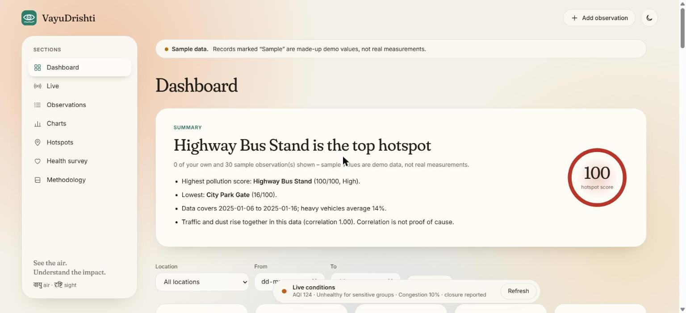
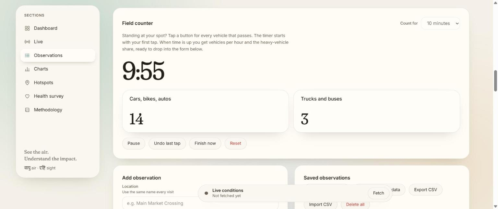
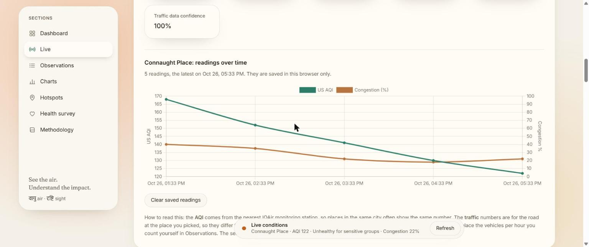
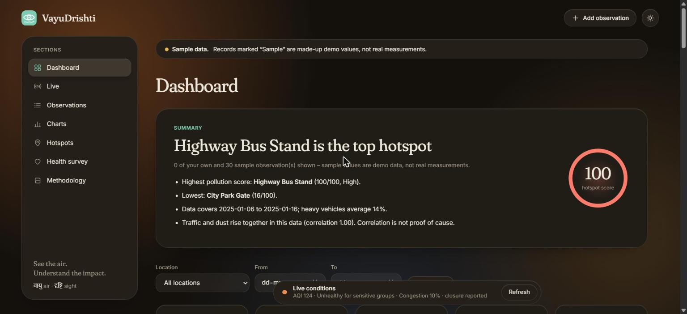
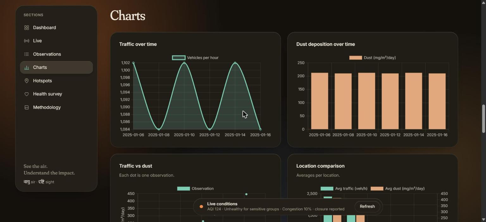

# VayuDrishti

*See the air. Understand the impact.*

[](https://github.com/PrateekSharma8800/vayudrishti/actions/workflows/test.yml)

**VayuDrishti** (वायुदृष्टि: *vayu* = air, *drishti* = sight) is a tool for studying air quality and traffic in a city. You count vehicles and measure dust at a few spots, and it ranks the spots, draws the charts and shows how traffic and dust move together. Next to your own field data it shows **live air quality and live traffic** for 46 places across Delhi NCR, with a plain-language note on what the air means for people.

No frameworks, no build step, no dependencies: plain HTML, CSS and JavaScript, plus a tiny Node server (or two serverless functions on Vercel) that keeps your API keys off the browser.



<details>
<summary>More screenshots</summary>






</details>

## What you can do

**Take your own readings (Observations)**
- **Field counter:** stand at a spot and tap one button per vehicle (cars, bikes and autos; trucks and buses). A 5, 10 or 15 minute timer starts on the first tap. At the end you get vehicles per hour and the heavy-vehicle share, and one button fills the form.
- **Dust calculator:** turn milligrams on a plate, its area and the days left out into mg/m²/day.
- **Records:** add, edit and delete observations; sort by any column; search by place, date or notes. Data lives in your browser.
- **CSV export and import:** move observations between devices. Imports are checked row by row; duplicates and demo rows are skipped and nothing existing is overwritten.
- **Sample data:** clearly labelled demo records to explore with, removable at any time without touching your own data.

**Understand them (Dashboard, Charts, Hotspots)**
- A summary, filters by place and date, and key numbers that count up when they change.
- Charts of traffic and dust over time, traffic against dust, and a comparison of places.
- Every place gets a hotspot score from 0 to 100 and a rank (see below).

**See the air right now (Live)**
- Pick one of **46 places in Delhi NCR** (no latitude or longitude needed) to get the US AQI from [IQAir](https://www.iqair.com/air-pollution-data-api) and speed and congestion from [TomTom](https://developer.tomtom.com/). "Somewhere else" accepts coordinates, and "Use my location" fills them.
- A ring shows the AQI, with a plain-language note for that band based on the US EPA's categories. The page's background haze takes the colour of the air.
- Every reading is saved in your browser and drawn as a **trend** for that place. An optional **15 minute auto-refresh** pauses while the tab is hidden.

**Ask people (Health survey)**
- An anonymous survey that stores counts only. Export your totals and add other people's files to combine a group.

**Share the result**
- **Print report:** a clean, dated report on white paper (or "Save as PDF" from the print dialog), whatever theme you were using.

**Comfortable to use**
- Light and dark themes, phone to desktop, keyboard friendly, honours reduced motion and reduced transparency. See [DESIGN.md](DESIGN.md).

## Quick start

Needs [Node.js](https://nodejs.org/) 20.12 or newer. There is nothing to install.

```bash
cp .env.example .env      # then add your two API keys (see below)
npm start                 # same as: node server.js
```

Open <http://localhost:8000>. Everything except **Live** also works by simply opening `public/index.html` in a browser.

New to the idea? Press **Load sample data** to see a finished study, then read the [user guide](docs/USER_GUIDE.md).

## API keys

The Live section needs two keys (both have free plans):

```
IQAIR_API_KEY=...
TOMTOM_API_KEY=...
```

Put them in `.env`, which is git-ignored. The server adds them to the provider calls itself, so they never reach the browser or the repository. When you deploy, set them as environment variables instead (see [docs/DEPLOY.md](docs/DEPLOY.md)).

- The AQI comes from the **nearest IQAir station city**, so places in one city often show the same number. The traffic numbers are for **the road at the place you picked**, so they differ.
- TomTom reports speed and congestion, **not vehicle counts**. It complements the vehicles per hour you count yourself.
- Free IQAir keys are small. The server reuses a reading for 10 minutes, limits each visitor and stops at a daily cap, so a busy page cannot use up your quota.

## How the hotspot score works

```
score = 40% dust + 40% traffic + 20% heavy-vehicle share
```

Each part is the place's average measured against a fixed reference (300 mg/m²/day, 2000 vehicles/h, 30% heavy) and capped at 1, so a score does not change just because another place was added. Below 40 is Low, 40 to 69 Moderate, 70 and above High. The references are teaching values you can change (`REF` in `public/app.js`); this is not an official air quality index.

## Deploy

One small Node process (or two serverless functions) and no database. **Vercel** is the recommended host: import the repository, add the two keys as environment variables, deploy. [docs/DEPLOY.md](docs/DEPLOY.md) has step-by-step instructions for Vercel, Render, Docker and any Node host, the full list of settings, and what to do when something goes wrong.

## Documentation

| Read this | If you want to |
|---|---|
| [docs/USER_GUIDE.md](docs/USER_GUIDE.md) | Run a field study and read the results (no coding needed) |
| [docs/DEPLOY.md](docs/DEPLOY.md) | Put it on the internet |
| [docs/ARCHITECTURE.md](docs/ARCHITECTURE.md) | Understand or change the code |
| [DESIGN.md](DESIGN.md) | Know why it looks and moves the way it does |
| [CHANGELOG.md](CHANGELOG.md) | See what changed and when |

## Project structure

| Path | What it is |
|---|---|
| `public/` | The site: `index.html`, `style.css`, `app.js` |
| `server.js` | Local, Docker and Render server (reads `.env`) |
| `lib/` | The live-data proxy and security headers, shared by every host |
| `api/`, `vercel.json` | Vercel serverless functions and settings |
| `scripts/sync-vercel.js` | Regenerates `vercel.json` from the page |
| `test/` | Tests (`npm test`) |
| `Dockerfile`, `render.yaml` | Docker and Render deployment |
| `.env.example` | The keys and optional settings |
| `docs/` | Guides and screenshots |

Charts use [Chart.js](https://www.chartjs.org/) from a CDN with an integrity hash; headings use Fraunces and Inter from Google Fonts (system fonts are the fallback).

## Tests

```bash
npm test
```

Node's built-in test runner, so there is still nothing to install. The tests cover the server, the Vercel functions, the live-data limits and cache, the security headers, and the whole app running in a small fake browser (`test/helpers/dom.js`). A GitHub Action runs them on Node 20 and 22 for every push and pull request, and builds the Docker image.

## Limits

- Small, non-random samples: results show patterns, not proof.
- Dust deposition is not the same as PM2.5 or PM10 concentration.
- The traffic and dust correlation pools all places, so differences between places can drive it.
- Place coordinates are approximate (a few hundred metres).
- Observations and survey totals are stored per browser. Export them regularly: clearing your browser's site data deletes them.
- The health notes are general guidance from US EPA categories, not medical advice.

## Privacy

Observations, survey totals and saved live readings never leave your browser. When the page opens it loads Chart.js from jsDelivr and the fonts from Google Fonts. Beyond that, the only network calls are the live-data requests you trigger, which go through the server to IQAir and TomTom with the coordinates of the place you chose. There are no accounts, cookies or analytics.
